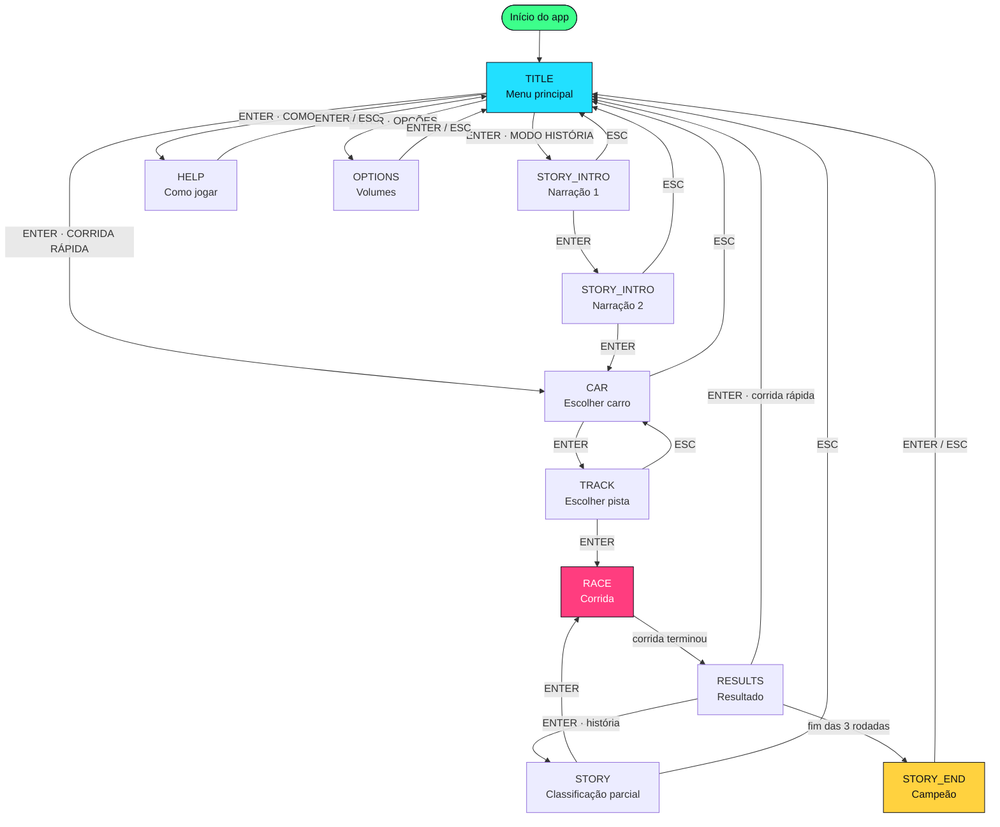
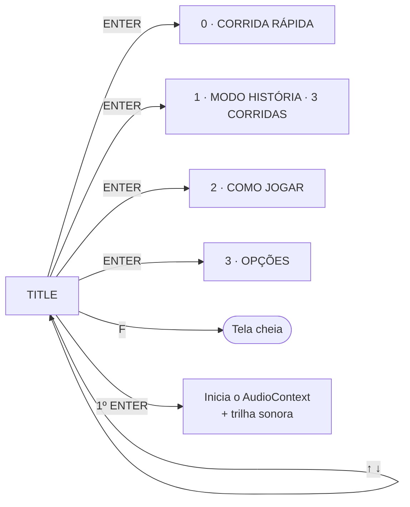
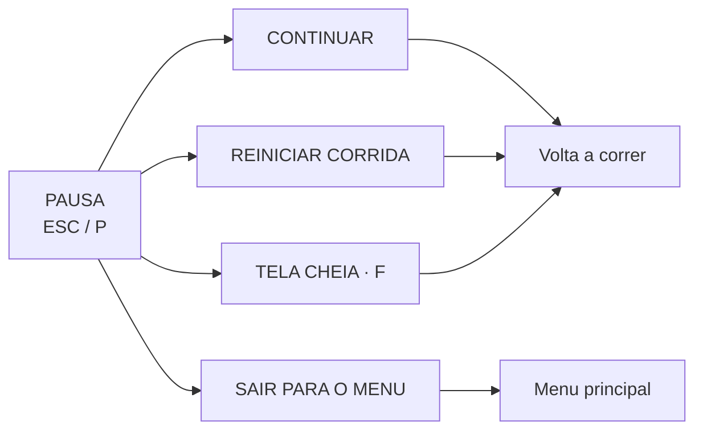

# 🎮 Fluxograma — Nitro Horizon

Documentação visual de **todo o fluxo do jogo**: telas, transições de estado, menu de
pausa, modo história e o ciclo da corrida.

Jogo: **https://renatinkkjk.github.io/nitro-horizon/**
Repositório do jogo: **https://github.com/renatinkkjk/nitro-horizon**

---

## 1. Mapa geral das telas

O jogo é uma máquina de estados finita. Cada bloco abaixo é uma tela
(`state`) do `src/game.ts`.



### Resumo das transições

| De | Para | Controle |
|---|---|---|
| `title` | `car` | ENTER (CORRIDA RÁPIDA) |
| `title` | `storyIntro` | ENTER (MODO HISTÓRIA) |
| `title` | `help` | ENTER (COMO JOGAR) |
| `title` | `options` | ENTER (OPÇÕES) |
| `storyIntro` | `storyIntro` | ENTER (avança a narração) |
| `storyIntro` | `car` | ENTER (fim da narração) |
| `car` | `track` | ENTER |
| `car` | `title` | ESC |
| `track` | `race` | ENTER |
| `track` | `car` | ESC |
| `race` | `results` | a corrida termina |
| `results` | `title` | ENTER (corrida rápida) |
| `results` | `story` / `storyEnd` | ENTER (história) |
| `story` | `race` | ENTER (próxima rodada) |
| `story` / `storyEnd` | `title` | ESC |

---

## 2. Menu principal (TITLE)



> O primeiro ENTER também **destrava o áudio** (exigência dos navegadores) e
> **liga a trilha sonora**.

---

## 3. Modo história (campeonato)

```mermaid
flowchart TD
    S0([MODO HISTÓRIA]) --> N1[NARRAÇÃO 1<br/>"o CEPK decidiu organizar um<br/>campeonato de corrida..."]
    N1 -->|ENTER| N2[NARRAÇÃO 2<br/>"... então você deve se provar ser<br/>o melhor e ganhar o campeonato<br/>kennedy!"]
    N2 -->|ENTER| ESC[ESCOLHER O CARRO<br/>vale para as 3 rodadas]
    ESC -->|ENTER| R1[RODADA 1<br/>DESERTO · 5 voltas]
    R1 --> RES1[RESULTADO + pontos]
    RES1 -->|ENTER| CL1[CLASSIFICAÇÃO PARCIAL]
    CL1 -->|ENTER| R2[RODADA 2<br/>LITORAL · 5 voltas]
    R2 --> RES2[RESULTADO + pontos]
    RES2 -->|ENTER| CL2[CLASSIFICAÇÃO PARCIAL]
    CL2 -->|ENTER| R3[RODADA 3<br/>CIDADE · 4 voltas]
    R3 --> RES3[RESULTADO + pontos]
    RES3 -->|ENTER| FIM[CAMPEÃO<br/>classificação final]
    FIM -->|ENTER / ESC| MENU[Menu principal]

    style N1 fill:#1a1a2a,stroke:#ffd23f,color:#f2f4ff
    style N2 fill:#1a1a2a,stroke:#ffd23f,color:#f2f4ff
    style FIM fill:#ffd23f,stroke:#0b0d17,color:#0b0d17
```

**Pontuação do campeonato** (top 10 receiving points):

| 1º | 2º | 3º | 4º | 5º | 6º | 7º | 8º | 9º | 10º |
|---|---|---|---|---|---|---|---|---|---|
| 15 | 12 | 10 | 8 | 6 | 5 | 4 | 3 | 2 | 1 |

A cada rodada o jogador soma **pontos + posição**; o desempate usa a soma das
posições obtidas.

---

## 4. Dentro da corrida (RACE)

```mermaid
flowchart TD
    C[COUNTDOWN<br/>3.8 s · "4 3 2 1 GO!"] --> R[RACING<br/>motor do carro]
    R -->|velocidade x nitro| R
    R -->|ESPAÇO · nitro| N[NITRO ATIVO<br/>+35% de velocidade máxima<br/>chama no escapamento]
    N -->|2,4 s| R
    R -->|R · olhar para trás| LB[VISÃO TRASEIRA<br/>pista espelhada]
    LB --> R
    R -->|bater / bater na pista| CRASH[CRASH<br/>tremor de tela + som]
    CRASH --> R
    R -->|entra no pit lane| PIT[PIT STOP<br/>reabastece + recarrega TODOS os nitros]
    PIT --> R
    R -->|cruza a linha de chegada| F[FINISHED]
    F --> RES([Tela de resultado])

    style C fill:#ffd23f,stroke:#0b0d17,color:#0b0d17
    style N fill:#22e0ff,stroke:#0b0d17,color:#0b0d17
    style PIT fill:#3dff8b,stroke:#0b0b0b,color:#0b0d17
```

### Durante a corrida

- **Fumaça nos pneus**: cresce com a velocidade e o quanto você está derrapando.
- **Chama de nitro**: sai dos dois escapamentos enquanto o nitro está ativo.
- **IA**: 14 adversários com habilidades diferentes, troca de faixa, respeita o
  *rubber band* (se você está na frente eles aceleram, se está atrás eles freiam) e
  faz *drafting* quando você gruda na traseira.
- **Combustível**: se acabar, o carro fica com 55% da força.

---

## 5. Menu de pausa (dentro da corrida)



> Com o jogo pausado, a música abaixa para **30%** do volume.

---

## 6. Telas do menu

| Tela | O que tem |
|---|---|
| **TITLE** | Logo, 4 opções de menu, mascote CEPK ao lado, botão de instalar o app |
| **CAR** | Showroom com o carro em vista lateral + 4 cards (um por modelo) com atributos |
| **TRACK** | 3 pistas (DESERTO, LITORAL, CIDADE) com dificuldade, voltas e o traçado |
| **HELP** | Tabela de controles (teclado e toque) |
| **OPTIONS** | Volume da **música** e dos **efeitos** (salvos no navegador) |
| **RESULTS** | Posição, tempo total, melhor volta e pontos ganhos no campeonato |
| **STORY** | Classificação parcial do campeonato entre as rodadas |
| **STORY_END** | Classificação final e o campeão |

---

## 7. Controles

| Ação | Teclado | Toque |
|---|---|---|
| Direita / esquerda | ← → ou A / D | ◀ ▶ |
| Acelerar | ↑ ou W | **GÁS** |
| Frear | ↓ ou S | **FREIO** |
| Nitro | **ESPAÇO** | **N₂O** |
| Olhar para trás | **R** | **RÉ** |
| Subir / descer marcha | SHIFT / CTRL (ou E / Q) | — |
| Confirmar | **ENTER** | **OK** |
| Voltar / pausar | **ESC** ou **P** | **II** |
| Tela cheia | **F** | **⛶** |

---

## 8. Fluxo em ASCII (para ver sem Mermaid)

```
                    ┌───────────┐
                    │   TITLE   │◄──────────────┐
                    └─────┬─────┘               │
       ┌────────────┬─────┴─────┬────────────┐  │
       ▼            ▼           ▼            ▼  │
  ┌─────────┐  ┌───────────┐ ┌────────┐ ┌─────────┐
  │   CAR   │  │STORY_INTRO│ │  HELP  │ │ OPTIONS │
  └────┬────┘  └─────┬─────┘ └────┬───┘ └────┬────┘
       │              │ (ENTER)   │          │
       │            ┌───────────┐ │          │
       │            │NARRAÇÃO 2 │ │          │
       │            └─────┬─────┘ │          │
       │ (ENTER)         │       │          │
       ▼              (ENTER)     │          │
  ┌────────┐            │         │          │
  │  TRACK │◄───┐       │         │          │
  └────┬───┘    │ESC    │         │          │
       │        │       │         │          │
   (ENTER)      │       │         │          │
       ▼        │       │         │          │
  ┌────────┐    │       │         │          │
  │  RACE  │    │       │         │          │
  └────┬───┘    │       │         │          │
       │ fim    │       │         │          │
       ▼        │       │         │          │
  ┌─────────┐  │       │         │          │
  │ RESULTS │  │       │         │          │
  └────┬────┘  │       │         │          │
       │        └───────┴─────────┴──────────┘
   (ENTER)
       ├──► TITLE
       └──► STORY ──(ENTER)──► RACE ──► STORY_END ──► TITLE
```

---

## 9. Como este fluxo foi gerado

O fluxograma espelha o código do jogo:

- `src/game.ts` → tipo `GameState` e o `switch (this.state)` do `update()`/`render()`
- `src/race/race.ts` → fases da corrida (`countdown` → `racing` → `finished`)
- `src/ui/screens.ts` → o que cada tela desenha

Diagrama em **Mermaid** (renderizado nativamente pelo GitHub) e uma versão em
**ASCII** para leitura em qualquer lugar.

---

Feito com 🏎️ por [renatinkkjk](https://github.com/renatinkkjk)
