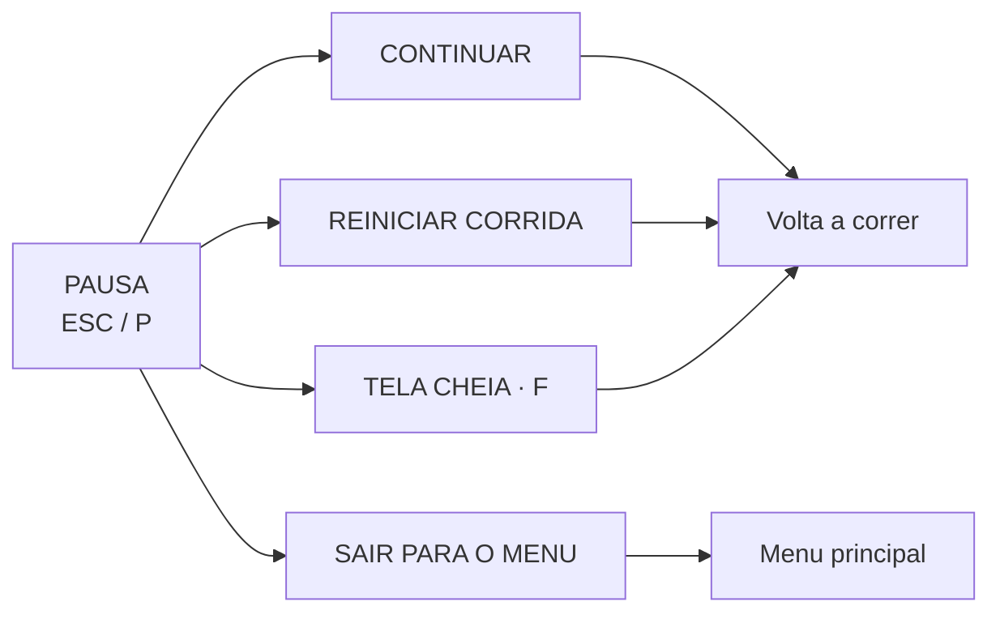

# 🎮 Fluxogramas — Nitro Horizon

Documentação visual de **dois sistemas** com fluxogramas:

1. **Sistema escolar** — autenticação, menu principal, funcionalidades e encerramento
2. **Lógica do jogo Nitro Horizon** — início, ações do jogador, decisões, vitória/derrota e encerramento

Jogo: **https://renatinkkjk.github.io/nitro-horizon/**
Código do jogo: **https://github.com/renatinkkjk/nitro-horizon**

---

## 📸 Os fluxogramas em imagem

### 1. Sistema escolar


**Arquivo:** [`docs/fluxograma-sistema-escolar.png`](docs/fluxograma-sistema-escolar.png)

### 2. Lógica do jogo (Nitro Horizon)


**Arquivo:** [`docs/fluxograma-jogo.png`](docs/fluxograma-jogo.png)

---

## 🔷 Símbolos usados (notação padrão)

| Símbolo | Significado | Onde aparece |
|---|---|---|
| ⭕ **Oval** | Início / Fim | Início do programa, FIM |
| ▭ **Retângulo** | Processo (ação) | Executar uma tarefa |
| ◇ **Losango** | Decisão (condição) | "Credenciais válidas?", "Cruzou a linha?" |
| ▱ **Paralelogramo** | Entrada / saída de dados | Login, escolha do jogador |
| ➡️ **Seta** | Fluxo / caminho | SIM, NÃO, HISTÓRIA... |

---

## 1️⃣ Fluxograma — Sistema escolar

```mermaid
flowchart TD
    A([INÍCIO]) --> B[/Entrar com usuário e senha/]
    B --> C{Credenciais válidas?}
    C -->|NÃO| D[Mostrar "acesso negado" e pedir novo login]
    D --> B
    C -->|SIM| E[MENU PRINCIPAL]
    E --> F{Qual módulo escolheu?}
    F -->|1| G[MATRÍCULA: cadastrar / paginar]
    F -->|2| H[NOTAS: lançar / consultar]
    F -->|3| I[FINANCEIRO: emitir boleto / consultar]
    F -->|4| J[Encerrar sessão (logout)]
    G --> E
    H --> E
    I --> E
    J --> K([FIM])

    style A fill:#ffe6f0,stroke:#1c2340,color:#1c2340
    style K fill:#ffe6f0,stroke:#1c2340,color:#1c2340
    style C fill:#fff6d6,stroke:#1c2340,color:#1c2340
    style F fill:#fff6d6,stroke:#1c2340,color:#1c2340
    style B fill:#e4fff2,stroke:#1c2340,color:#1c2340
```

**Regras principais**

- A **autenticação** acontece antes de qualquer menu.
- Login inválido → mostra o aviso e **volta** para a tela de entrada.
- Cada módulo do menu **devolve** o usuário ao Menu Principal.
- **Só a opção "Sair"** encerra a sessão e chega ao FIM.

### Resumo das etapas

| Etapa | Símbolo | Descrição |
|---|---|---|
| 1 | Oval | Início |
| 2 | Paralelogramo | Entrada: usuário e senha |
| 3 | Losango | Credenciais válidas? |
| 4 | Retângulo | Acesso negado → volta ao login |
| 5 | Retângulo | Menu principal |
| 6 | Losango | Qual módulo escolheu? |
| 7 | Retângulo | Matrícula / Notas / Financeiro |
| 8 | Retângulo | Encerrar sessão (logout) |
| 9 | Oval | Fim |

---

## 2️⃣ Fluxograma — Lógica do jogo (Nitro Horizon)

```mermaid
flowchart TD
    A([INÍCIO]) --> B[Carregar o jogo (tela inicial)]
    B --> C{Modo de jogo?}
    C -->|HISTÓRIA| D[Narrativa → escolher carro → 3 rodadas]
    C -->|CORRIDA RÁPIDA| E[/Escolher carro e pista/]
    D --> E
    E --> F[Contagem regressiva 3-2-1]
    F --> G[CORRIDA: acelerar, frear, nitro, olhar atrás]
    G --> H{Cruzou a linha de chegada?}
    H -->|NÃO| I{Tempo esgotou / perdeu demais?}
    I -->|SIM| J[DERROTA: mostrar resultado]
    I -->|NÃO| G
    H -->|SIM| K[VITÓRIA! Mostrar resultado]
    K --> L{Modo história?}
    L -->|SIM| M[Somar pontos do campeonato (faltam rodadas?)]
    M --> F
    L -->|NÃO| N([FIM])
    J --> N

    style A fill:#ffe6f0,stroke:#1c2340,color:#1c2340
    style N fill:#ffe6f0,stroke:#1c2340,color:#1c2340
    style C fill:#fff6d6,stroke:#1c2340,color:#1c2340
    style H fill:#fff6d6,stroke:#1c2340,color:#1c2340
    style I fill:#fff6d6,stroke:#1c2340,color:#1c2340
    style L fill:#fff6d6,stroke:#1c2340,color:#1c2340
    style E fill:#e4fff2,stroke:#1c2340,color:#1c2340
```

**Regras principais**

- O jogador escolhe o **modo**, o **carro** e a **pista**.
- Durante a corrida: acelerar, frear, nitro (ESPAÇO) e olhar para trás (R).
- **Cruzou a linha = VITÓRIA.** Tempo esgotou / perdeu demais = **DERROTA**.
- No modo história os pontos somam e o campeonato continua até o fim.

### Resumo das etapas

| Etapa | Símbolo | Descrição |
|---|---|---|
| 1 | Oval | Início |
| 2 | Retângulo | Carregar o jogo (tela inicial) |
| 3 | Losango | Modo de jogo? (rápida / história) |
| 4 | Paralelogramo | Escolher carro e pista |
| 5 | Retângulo | Contagem regressiva 3-2-1 |
| 6 | Retângulo | Corrida (ações do jogador) |
| 7 | Losango | Cruzou a linha de chegada? |
| 8 | Losango | Tempo esgotou / perdeu demais? |
| 9 | Retângulo | Vitória / Derrota — mostrar resultado |
| 10 | Losango | Modo história? (continuar campeonato) |
| 11 | Oval | Fim |

---

## 🗺️ Mapa detalhado das telas do jogo

O diagrama abaixo detalha **cada tela** do jogo (é a mesma máquina de estados
implementada em `src/game.ts`):


### Transições

| De | Para | Controle |
|---|---|---|
| `title` | `car` | ENTER (CORRIDA RÁPIDA) |
| `title` | `storyIntro` | ENTER (MODO HISTÓRIA) |
| `title` | `help` | ENTER (COMO JOGAR) |
| `title` | `options` | ENTER (OPÇÕES) |
| `storyIntro` | `storyIntro` | ENTER (avança a narração) |
| `storyIntro` | `car` | ENTER (fim da narração) |
| `car` | `track` | ENTER |
| `car` | `title` | ESC |
| `track` | `race` | ENTER |
| `track` | `car` | ESC |
| `race` | `results` | a corrida termina |
| `results` | `title` | ENTER (corrida rápida) |
| `results` | `story` / `storyEnd` | ENTER (história) |
| `story` | `race` | ENTER (próxima rodada) |
| `story` / `storyEnd` | `title` | ESC |

### Menu de pausa (dentro da corrida)



### Pontuação do campeonato (modo história)

| 1º | 2º | 3º | 4º | 5º | 6º | 7º | 8º | 9º | 10º |
|---|---|---|---|---|---|---|---|---|---|
| 15 | 12 | 10 | 8 | 6 | 5 | 4 | 3 | 2 | 1 |

### Controles

| Ação | Teclado | Toque |
|---|---|---|
| Direita / esquerda | ← → ou A / D | ◀ ▶ |
| Acelerar | ↑ ou W | **GÁS** |
| Frear | ↓ ou S | **FREIO** |
| Nitro | **ESPAÇO** | **N₂O** |
| Olhar para trás | **R** | **RÉ** |
| Subir / descer marcha | SHIFT / CTRL (ou E / Q) | — |
| Confirmar | **ENTER** | **OK** |
| Voltar / pausar | **ESC** ou **P** | **II** |
| Tela cheia | **F** | **⛶** |

---

## 🛠️ Como as imagens foram geradas

Os dois PNGs são desenhados por código (sem editor), em
[`tools/make-flowcharts.cjs`](tools/make-flowcharts.cjs), usando **Jimp**:

```bash
npm install     # instala o jimp
npm run gerar   # recria docs/*.png
```

O script desenha cada símbolo na mão (oval, retângulo, losango, paralelogramo),
as setas com ponta e o texto centralizado — por isso o resultado é sempre igual.

| Arquivo | O que é |
|---|---|
| `tools/make-flowcharts.cjs` | Gera os dois fluxogramas em PNG |
| `tools/check-flowcharts.cjs` | Confere as cores/símbolos de cada imagem |

---

Feito com 🏎️ por [renatinkkjk](https://github.com/renatinkkjk)
